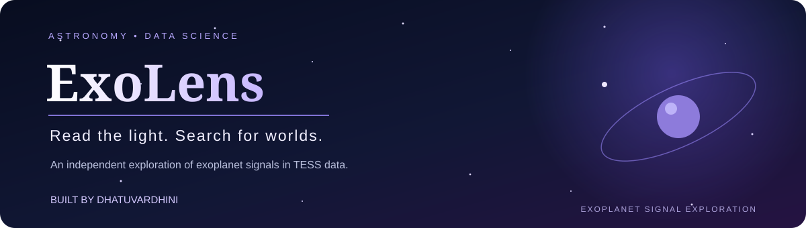

<p align="center">
  
</p>

---
### 🚀 Live Demo
**Explore ExoLens:** [Open the live website](https://dhatuvardhini07.github.io/ExoLens/)

### *Read the light. Search for worlds.*

# ExoLens Python engine

**A small observatory in your browser.**

ExoLens is an independent astronomy and data-science project that explores transit-like signals in real data from NASA’s Transiting Exoplanet Survey Satellite (TESS). It brings light-curve analysis, period searching, and scientific visualisation into one place—helping users investigate the subtle changes in starlight that may reveal an orbiting planet.

> *Every star has a story written in its light. ExoLens is a step toward learning how to read it.*

---

<p align="center">

🔭 **Real TESS light curves** · 📈 **BLS period search** · 🪐 **Transit-signal exploration**

</p>

<p align="center">
  
  
  
  
</p>

---

## ✦ The idea behind ExoLens

An exoplanet can be difficult to observe directly. One way astronomers search for planets is by studying a star's brightness over time.

When a planet passes in front of its host star from our point of view, the observed brightness may dip slightly. This is known as the **transit method**.

ExoLens explores this idea through a data-analysis workflow that works with light-curve observations, searches for repeating transit-like patterns, and presents the results for further investigation.

The aim is to make the journey from raw observations to an interpretable analysis more accessible, understandable, and reproducible.

**The central question:**

*Can we identify a promising periodic signal in a star's light curve—and understand what the data actually support?*

## ✦ What ExoLens explores

| Feature | What it does |
|---|---|
| **Light-curve analysis** | Examines stellar brightness measurements over time. |
| **BLS period search** | Uses the Box Least Squares algorithm to search for periodic, transit-shaped signals. |
| **Periodogram** | Visualises the search across trial periods to help inspect promising peaks. |
| **Phase-folded curve** | Folds observations over a selected period to inspect whether a repeating pattern becomes clearer. |
| **Transit-window depth estimate** | Estimates the relative brightness decrease when enough observations support the calculation. |
| **Structured analysis results** | Exports analysis metadata and results in JSON, with an optional flattened CSV summary. |
| **Web interface** | Provides a React + TypeScript interface connected to a FastAPI backend. |

*Visualisations and results should be interpreted within the capabilities and limitations of the current implementation.*

## ✦ The science: from starlight to signal

ExoLens uses the **Box Least Squares (BLS)** method to investigate whether a light curve contains a repeating, transit-like dip.

The workflow is designed around the following stages:

1. **Obtain the observations**  
   Load a local light-curve CSV or select a TESS target and an available data product.

2. **Prepare the data**  
   Check observations, handle quality flags, and normalise the flux measurements.

3. **Search for periodicity**  
   Evaluate trial periods and transit durations using BLS.

4. **Inspect the candidate signal**  
   Examine the light curve, periodogram, and phase-folded representation where available.

5. **Estimate and report**  
   Calculate a transit-window depth estimate when the data support it, then export the result with relevant provenance and analysis metadata.

6. **Interpret cautiously**  
   Treat the output as an analysis result requiring validation—not as proof that a planet exists.

### The three scientific views

**1. Light curve — brightness over time**

Shows how the observed stellar brightness changes across the observation period.

**2. Periodogram — searching for repetition**

Shows the BLS search across trial periods, helping identify periods worth investigating further.

**3. Phase-folded curve — looking for a repeating pattern**

Places observations from different cycles on a shared phase axis so a potential repeating dip can be inspected.

Together, these views help connect the numerical search to the underlying astronomical observations.

## ✦ Project architecture

ExoLens is organised into three main layers.

```text
                    EXOLENS
                       │
          ┌────────────┴────────────┐
          │                         │
     Web Interface             Analysis Engine
   React + TypeScript              Python
          │                         │
          │                    Light-curve data
          │                         │
          ▼                         ▼
       FastAPI ───────────► Data preparation
          │                         │
          │                         ▼
          │                    BLS period search
          │                         │
          ▼                         ▼
      Job / Result API ◄──── Analysis output
          │
          ▼
    Results visualisation
    and browser-local history
```

### Technology stack

| Layer | Technology | Purpose |
|---|---|---|
| Frontend | React | User interface |
| Frontend language | TypeScript | Typed application development |
| Backend API | FastAPI | Analysis job and result endpoints |
| Analysis | Python | Light-curve processing and scientific calculations |
| Period search | Astropy BLS | Periodic transit-like signal search |
| Astronomical data | Lightkurve / TESS products | Working with astronomical light curves |
| Testing | pytest | Automated Python tests |
| Results | JSON and CSV | Structured output and summaries |

## ✦ Project structure

```text
ExoLens/
├── backend/                  # Python analysis engine and API
├── frontend/                 # React + TypeScript application
├── docs/                     # Technical documentation
├── notebooks/
│   └── hackathon-baseline.ipynb
├── .gitignore
├── pyproject.toml
├── package-lock.json
└── README.md
```

The `notebooks/hackathon-baseline.ipynb` file preserves the original notebook-stage work associated with the hackathon project.

The later ExoLens implementation organises the analysis into a more structured application with a Python engine, API, and web interface. The notebook and the application should therefore be understood as related stages of the project, not as identical implementations.

## ✦ Getting started

### Prerequisites

- Python compatible with the dependency requirements in `pyproject.toml`
- Node.js and npm for the frontend
- Git
- Internet access when retrieving data from the MAST archive

### 1. Clone the repository

```bash
git clone https://github.com/Dhatuvardhini07/ExoLens.git
cd ExoLens
```

### 2. Set up the Python environment

On Windows, open the project in VS Code and run:

```powershell
python -m venv .venv
.\.venv\Scripts\Activate.ps1
python -m pip install --upgrade pip
python -m pip install -e ".[dev]"
```

If PowerShell blocks environment activation, you can use the virtual environment's Python executable directly instead.

### 3. Run the tests

```powershell
python -m pytest
```

### 4. Start the frontend and API

The frontend and backend have their own setup requirements. Follow the instructions in `frontend/README.md` and the relevant backend documentation for the current development commands and configuration.

## ✦ Analyse your own light curve

ExoLens supports local CSV files with `time` and `flux` columns. Optional columns include `flux_err` and `quality`.

Example:

```powershell
exolens analyze-file .\path\to\light_curve.csv `
  --time-system "BTJD (BJD - 2457000)" `
  --period-min-days 0.5 `
  --period-max-days 20 `
  --duration-min-hours 0.5 `
  --duration-max-hours 6 `
  --output .\data\results\analysis.json
```

Time values are interpreted in days. Specify the time system when known; ExoLens does not infer it automatically.

### Analyse a TESS target

```powershell
exolens analyze-tic 123456789 `
  --sector 12 `
  --author TESS-SPOC `
  --period-min-days 0.5 `
  --period-max-days 20 `
  --duration-min-hours 0.5 `
  --duration-max-hours 6 `
  --output .\data\results\tic-analysis.json
```

Replace the example target and sector with the ones you want to investigate. Retrieving a TESS product requires network access to the MAST archive, and product selection may need to be made more specific.

For further options and output details, see `docs/` and the Python package documentation.

## ✦ An exploratory result

During development, ExoLens was used to explore **TIC 39728879, TESS Sector 6**.

The BLS search returned a period near **8.005 days**. However, the best-fit transit duration reached the boundary of the configured search range, so the transit-depth estimate was withheld.

The result remains **unvalidated**. It is an exploratory signal, not a confirmed exoplanet detection.

This example illustrates why a promising period alone is not enough: data quality, search configuration, statistical significance, and independent validation all matter.

## ✦ Scientific limitations and responsible interpretation

ExoLens is an exploratory analysis tool, not a planet-confirmation system.

- A BLS peak is a candidate search result, not proof of a planet.
- The current implementation does not provide calibrated detection significance, false-alarm probability (FAP), or signal-to-noise ratio (SNR).
- Detection thresholds have not been calibrated, so results use `signal_status=not_evaluated`.
- Results remain marked `unvalidated`.
- Transit-window depth is reported only when enough in-window and out-of-window observations are available. It is withheld when the best-fit duration lies at a search boundary.
- Instrumental effects, stellar variability, data quality, and other astrophysical explanations may produce transit-like signals.
- Independent validation and additional evidence are needed before making a scientific claim about an exoplanet.

**ExoLens does not claim to have discovered or confirmed an exoplanet.** Its purpose is to support investigation, analysis, and learning.

## ✦ Origin story

ExoLens grew out of work associated with the **Bharatiya Antariksh Hackathon 2026 — Problem Statement 07**.

The original Jupyter notebook is preserved in the repository as a record of the hackathon-stage analysis. The subsequent application represents a separate development stage, extending the work into a more structured and accessible software project.

The project brings together astronomy, data analysis, scientific visualisation, and software engineering to explore a fascinating question: what can we learn by studying the light that reaches us from distant stars?

## ✦ Future directions

Potential areas for further development include:

- Better uncertainty estimates and calibrated signal-significance metrics.
- More comprehensive validation workflows.
- Clearer data-quality and provenance reporting.
- Additional tools for comparing candidate signals across observations.
- Improved visual explanations of BLS results and their limitations.
- Further usability and testing improvements across the application.

These are development directions, not claims that the features are already implemented.

## ✦ Contributing

Suggestions, bug reports, and thoughtful feedback are welcome.

If you are interested in astronomy, exoplanets, Python, data science, or scientific software, feel free to explore the code and open an issue to discuss a possible improvement.

## ✦ Acknowledgements

- **NASA TESS** for the astronomical observations that make transit searches possible.
- **MAST** for access to relevant mission data products.
- The open-source scientific Python ecosystem, including Astropy and Lightkurve.

Please consult the relevant project and data-source terms when reusing code or observations.

---

<p align="center">

### 🌠 ExoLens
**Read the light. Search for worlds.**

*An independent exploration of astronomy, data, and the signals hidden in starlight.*

</p>
